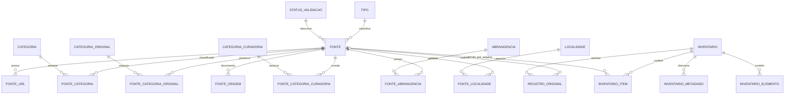

# Catálogo relacional OSINT Rondônia

## Arquitetura

O Data Package v2 publica os CSV sob `data/`. A tabela `fonte` reúne as 4.571 fichas JSON individuais e sete referências incluídas explicitamente no TODO, totalizando 4.578 fontes. Estas sete referências permanecem com `status_triagem=pendente`, sem tipo ou status de validação inferidos. Inventários compostos continuam sendo documentos de natureza diferente e têm uma linha por documento em `inventario`; os 7.749 itens encontrados nas coleções são reunidos em `inventario_item.csv`, com uma coluna por campo observado. Campos não presentes em determinado item ficam nulos; objetos e listas são serializados como JSON canônico em sua coluna. `inventario_item.fonte_id` é opcional e só aponta para uma ficha quando a referência de origem permite associação exata. Nenhum item é deduplicado.

`registro_original.csv` retém caminho relativo, tipo do documento e SHA-256 para rastreabilidade. A validação cotidiana usa somente os CSV. Os hashes identificam os originais, mas não recuperam seu conteúdo. Os CSV são a fonte principal do catálogo e não são regenerados automaticamente dos documentos legados.

As sete referências que constavam em `TODO.md` tornaram-se linhas pendentes de `fonte`, com seus 16 endereços em `fonte_url`; suas seções originais estão em `fonte_origem` com `tipo_origem=secao_todo`. O link local de rótulo “pendências históricas” está preservado pelo próprio caminho de origem na tabela `inventario`. Contexto, objetivo e atividades foram transferidos para o README, fora do catálogo tabular. A nota original acompanha as sete fontes para deixar claro que são referências para avaliação, não fontes OSINT auditadas ou dependências aprovadas.

## Diagrama



`inventario_item` reúne os formatos que antes geravam 26 tabelas separadas. Seus 68 campos incluem seis campos estruturais e a união dos atributos observados.

## Tabelas e chaves

| Recurso | Responsabilidade | Chave primária |
| --- | --- | --- |
| `fonte` | Ficha, atributos escalares comuns, ID externo e status legado | `id` |
| `tipo`, `status_validacao` | Vocabulários exatos encontrados nas fichas | `id` |
| `categoria` | Rótulos de todas as classificações; `tipo_classificacao` distingue `principal`, `original` e `curadoria` | `id` |
| `fonte_categoria` | Relação N:N única entre fontes e categorias, preservando o tipo da categoria associada | chave composta (`fonte_id`, `categoria_id`) |
| `fonte_url` | URL principal e links relacionados; compartilhamento não implica identidade | `id` |
| `abrangencia`, `fonte_abrangencia` | Valores literais de abrangência | `id`; relação composta |
| `localidade`, `fonte_localidade` | Município, UF e país explicitamente declarados, sem completar lacunas | `id`; relação composta |
| `fonte_origem` | Proveniência dos campos `origem`, `origem_cadastro` e seção de referência do TODO | (`fonte_id`, `tipo_origem`) |
| `inventario` | Documento composto, caminho, título e hash | `id` |
| `inventario_item` | Itens tabulares de todas as coleções aninhadas, sem deduplicação | `id` |
| `inventario_elemento` | Elementos de listas primitivas/mistas por JSON Pointer | `id` |
| `inventario_metadado` | Valores escalares de metadados irregulares de inventário | `id` |
| `registro_original` | Referência e hash de cada JSON de origem | `id` |

Cada relação declara as chaves estrangeiras no descritor. `fonte.status_triagem` permanece nulo porque os JSON não fornecem esse status editorial. `status_validacao` preserva o texto legado, sem traduzi-lo para um estado de aprovação. Disponibilidade de URL não é inferida a partir desses textos.

### Campos e preservação

Os campos escalares observados nas fichas estão em `fonte`; os atributos que representam várias URLs, classificações, abrangências, localidades e proveniência usam tabelas relacionadas. A dimensão `categoria` reúne os rótulos dos campos principal, original e de curadoria, sem fundir termos; `tipo_classificacao` preserva de qual campo cada rótulo veio. `fonte_categoria` é a única relação entre fichas e categorias. Os campos de `inventario_item` mantêm os tipos originais compatíveis entre os itens: textos, booleano e inteiro. Objetos e listas em um campo são JSON canônico. Os itens e elementos têm JSON Pointer e identificador do documento de origem. Os arquivos originais foram removidos após verificação; caminho e hash permitem rastrear cada linha, mas não recuperar os bytes originais.

O token `\N` representa valor nulo e está declarado como `missingValues`; ele é reservado e uma colisão literal interrompe a importação explicitamente. Strings vazias continuam vazias. A distinção original entre campo ausente e nulo foi verificada antes do corte e permanece documentada nos dados tipados e no hash registrado; o documento byte a byte deixa de ser recuperável depois da remoção. A exportação não normaliza pontuação, capitalização, idioma, URLs ou rótulos.

## Identificadores

Os IDs atuais são valores persistentes gravados diretamente nas tabelas CSV. Edições devem manter os IDs; uma alteração de nome, descrição ou URL não cria outra identidade. Ao incluir um registro, atribua um novo ID que não exista no respectivo CSV e nunca reutilize IDs removidos. Os IDs `src-*`, `todo-*`, `inv-*` e `url-*` existentes foram preservados da importação inicial.

IDs externos (por exemplo, `BRAPI-00001`) ficam em `fonte.id_externo`; nunca substituem a chave interna. Itens de inventário só recebem `fonte_id` quando o campo de referência aponta exatamente para um caminho de ficha existente. Semelhança de nome ou URL não cria vínculo.

## Execução

Requer Docker com Compose e Just no host. Python, Frictionless e SQLAlchemy ficam na imagem definida em `.config/container/Dockerfile`; os comandos de dados e testes executam dentro do contêiner. `.config` guarda a configuração, `.cache` recebe caches descartáveis e `.local/share/osint-rondonia` é staging ignorado pelo Git. O SQLite publicado é versionado em `data/exports/catalog.sqlite`.

```bash
# Construir a imagem com dependências fixadas
just build

# Validar Data Package, CSV, tipos e relações
just validate

# Testar integridade, exportação SQLite e reprodutibilidade
just test

# Gerar SQLite com todas as tabelas do Data Package
just sqlite

# Executar o gate com comparação do SQLite da revisão
just check
```

`just sqlite` valida primeiro o descritor com Frictionless e as regras relacionais do projeto. O exportador lê as linhas tipadas pelos recursos Frictionless, cria as tabelas com chaves primárias e estrangeiras e grava em staging; só substitui o SQLite versionado depois de passar `integrity_check`, `foreign_key_check` e contagens por tabela. A execução é determinística e uma falha preserva a versão publicada anterior.

O SQLite contém os 20 recursos do pacote, inclusive inventários. As chaves estrangeiras estão declaradas no arquivo; aplicações que alterarem os dados devem habilitar sua verificação por conexão com `PRAGMA foreign_keys = ON`.

## Contribuições

Para incluir ou alterar uma ficha, edite os CSV e suas relações, mantendo os IDs e respeitando as FKs. Uma ficha precisa ter uma linha em `fonte`; adicione suas categorias, URLs, abrangência, localidade e proveniência nas respectivas tabelas. Para remover uma ficha, remova primeiro as relações que a referenciam. Não reutilize IDs removidos.

Para adicionar novos itens de inventário, atualize `inventario_item.csv`, preenchendo o `inventario_id`, JSON Pointer e os campos existentes que se aplicam. Campos novos exigem atualização do descritor, do validador e do exportador SQLite quando aplicável. Não trate documentos agregadores como fichas independentes. Rode `just check` antes do pull request.

O workflow `.github/workflows/validar-catalogo.yml` constrói a imagem e executa validação Data Package v2, integridade CSV/FK, testes e comparação do SQLite em Docker. Contexto, objetivo e atividades do antigo backlog estão no README. As sete referências estão em `fonte.csv` e seus links em `fonte_url.csv`; mantenha a triagem como pendente até revisão editorial. A licença AGPL-3.0-or-later cobre o código do repositório; licenças de dados externos não são herdadas automaticamente e não foram declaradas como uma licença única do pacote.

## Gate e auditoria

O check **Gate do catálogo** roda em todos os PRs, inclusive os que alteram
somente documentação, e nos pushes para `main`. `just check` executa as
verificações em Docker e compara o SQLite regenerado com o arquivo do
`HEAD`. Para testar mudanças nos dados, gere o banco com `just sqlite` e
inclua os CSV e o SQLite na mesma revisão. O gate usa a revisão Git como
referência e deixa o SQLite da árvore de trabalho intacto.

`just lint` executa actionlint, zizmor, Hadolint, yamllint, Ruff, ShellCheck e
Gitleaks. A varredura de segredos cobre os arquivos de trabalho, incluindo
os CSV. `just audit` roda Trivy, OSV-Scanner e Semgrep e salva JSON, SBOM
CycloneDX e proveniência em `.local/audit/`. O workflow de auditoria roda
semanalmente na branch padrão e aceita disparo manual. Ele publica os
relatórios mesmo se houver achados ou falha de scanner.

O Dockerfile instala as versões do lockfile em
`.config/container/requirements.txt`. A configuração do Renovate propõe
atualizações por PR quando a integração estiver habilitada no repositório.
Antes de exigir o check na proteção de branch, registre um PR somente com
documentação, um PR com falha intencional e uma auditoria manual com o
artefato associado à revisão.
