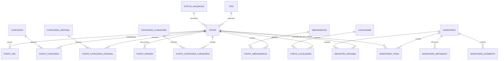

# Catálogo relacional OSINT Rondônia

## Arquitetura

O Data Package v2 publica os CSV sob `data/`. A tabela `fonte` representa as 4.571 fichas individuais. Inventários compostos continuam sendo documentos de natureza diferente e têm uma linha por documento em `inventario`; seus itens são exportados em recursos `inventario_itens_<hash>` organizados pela forma dos campos de cada coleção. O hash no nome do recurso depende do conjunto ordenado de campos, não da posição dos registros.

Após a verificação inicial de cobertura, os JSON legados e `TODO.md` são removidos individualmente. `registro_original.csv` retém caminho relativo, tipo do documento e SHA-256; `cutover_audit.csv` registra hash, contagens associadas e confirmação de cobertura de cada arquivo removido. Permanecem o descritor v2, `data/id_manifest.json` e `data/migration_report.json`. O manifesto mantém IDs para referência e auditoria; a validação cotidiana usa somente CSV. Os hashes permitem verificar os arquivos se reaparecerem, mas não recuperá-los do pacote.

O backlog de `TODO.md` também é exportado em `item_todo.csv` e `todo_url.csv`: contexto, objetivo, sete referências de implementação e doze atividades. Todos recebem `status_triagem=pendente`. As referências ficam separadas de `fonte`, pois o próprio TODO diz que não são fontes OSINT auditadas nem dependências aprovadas. As URLs externas e o link local para o inventário histórico ficam na relação `todo_url`.

## Diagrama



`INVENTARIO_ITENS` no diagrama representa a família de recursos `inventario_itens_<hash>` gerada para cada formato de coleção encontrado.

## Tabelas e chaves

| Recurso | Responsabilidade | Chave primária |
| --- | --- | --- |
| `fonte` | Ficha, atributos escalares comuns, ID externo e status legado | `id` |
| `tipo`, `status_validacao` | Vocabulários exatos encontrados nas fichas | `id` |
| `categoria`, `categoria_original`, `categoria_curadoria` | Termos mantidos em dimensões separadas, sem equivalências inferidas | `id` |
| `fonte_categoria`, `fonte_categoria_original`, `fonte_categoria_curadoria` | Relações N:N das três classificações | chave composta (`fonte_id`, `categoria_id`) |
| `fonte_url` | URL principal e links relacionados; compartilhamento não implica identidade | `id` |
| `abrangencia`, `fonte_abrangencia` | Valores literais de abrangência | `id`; relação composta |
| `localidade`, `fonte_localidade` | Município, UF e país explicitamente declarados, sem completar lacunas | `id`; relação composta |
| `fonte_origem` | Proveniência dos campos `origem` e `origem_cadastro` | (`fonte_id`, `tipo_origem`) |
| `inventario` | Documento composto, caminho, título e hash | `id` |
| `inventario_itens_<hash>` | Itens tabulares de coleções aninhadas por formato encontrado | `id` |
| `inventario_elemento` | Elementos de listas primitivas/mistas por JSON Pointer | `id` |
| `inventario_metadado` | Valores escalares de metadados irregulares de inventário | `id` |
| `registro_original` | Referência e hash de cada JSON de origem | `id` |
| `item_todo` | Contexto, objetivo, referências e atividades do backlog | `id` |
| `todo_url` | URLs e caminhos citados por um item do backlog | `id` |

Cada relação declara as chaves estrangeiras no descritor. `fonte.status_triagem` permanece nulo porque os JSON não fornecem esse status editorial. `status_validacao` preserva o texto legado, sem traduzi-lo para um estado de aprovação. Disponibilidade de URL não é inferida a partir desses textos.

### Campos e preservação

Os campos escalares observados nas fichas estão em `fonte`; os atributos que representam várias URLs, classificações, abrangências, localidades e proveniência usam tabelas relacionadas. Campos excepcionais nos itens de inventário são escritos como valores tipados; objetos e listas em uma coluna usam JSON canônico, além de seus elementos internos em tabelas com JSON Pointer. Os arquivos originais foram removidos após verificação; caminho e hash permitem rastrear cada linha, mas não recuperar os bytes originais.

O token `\N` representa valor nulo e está declarado como `missingValues`; ele é reservado e uma colisão literal interrompe a importação explicitamente. Strings vazias continuam vazias. A distinção original entre campo ausente e nulo foi verificada antes do corte e permanece documentada nos dados tipados e no hash registrado; o documento byte a byte deixa de ser recuperável depois da remoção. A exportação não normaliza pontuação, capitalização, idioma, URLs ou rótulos.

## Identificadores

O manifesto contém uma chave de identidade de origem para cada ID. Fichas usam `fonte:<caminho relativo>`; itens usam `item:<caminho relativo>#<JSON Pointer>`; dimensões usam o valor literal da dimensão. O ID é derivado da chave e gravado no manifesto. Uma nova execução reaproveita a atribuição existente; nomes, descrições, URLs e ordem das linhas não participam da identidade. Ao renomear um JSON, mantenha o ID anterior no manifesto e mova sua chave de origem para o novo caminho antes de importar.

IDs externos (por exemplo, `BRAPI-00001`) ficam em `fonte.id_externo`; nunca substituem a chave interna. Itens de inventário só recebem `fonte_id` quando o campo de referência aponta exatamente para um caminho de ficha existente. Semelhança de nome ou URL não cria vínculo.

## Execução

Requer Docker com Compose e Just no host. Python, Frictionless e SQLAlchemy ficam na imagem definida em `.config/container/Dockerfile`; os comandos de dados e testes executam dentro do contêiner. `.config` guarda a configuração, `.cache` recebe caches descartáveis e `.local/share/osint-rondonia` é staging ignorado pelo Git. O SQLite publicado é versionado em `data/exports/catalog.sqlite`.

```bash
# Construir a imagem com dependências fixadas
just build

# Validar Data Package, CSV, tipos e relações
just validate

# Testar integridade, exportação SQLite e reprodutibilidade
just test

# Gerar SQLite com todas as tabelas do Data Package
just sqlite

# Executar o gate com comparação do SQLite da revisão
just check
```

`just sqlite` valida primeiro o descritor com Frictionless e as regras relacionais do projeto. O exportador lê as linhas tipadas pelos recursos Frictionless, cria as tabelas com chaves primárias e estrangeiras e grava em staging; só substitui o SQLite versionado depois de passar `integrity_check`, `foreign_key_check` e contagens por tabela. A execução é determinística e uma falha preserva a versão publicada anterior.

O SQLite contém os 48 recursos do pacote, inclusive inventários e backlog. As chaves estrangeiras estão declaradas no arquivo; aplicações que alterarem os dados devem habilitar sua verificação por conexão com `PRAGMA foreign_keys = ON`.

## Contribuições

Para incluir ou alterar uma ficha, edite os CSV e suas relações, mantendo os IDs e respeitando as FKs. Uma ficha precisa ter uma linha em `fonte`; adicione suas categorias, URLs, abrangência, localidade e proveniência nas respectivas tabelas. Para remover uma ficha, remova primeiro as relações que a referenciam. Não reutilize IDs removidos.

Para adicionar novos itens de inventário, atualize o recurso tabular correspondente e `inventario_id`/JSON Pointer; se o formato exigir nova família de colunas, ajuste o descritor e os CSV. Não trate inventários como fichas independentes nem regenere o catálogo usando o importador legado após o corte. Rode `just check` antes do pull request.

O workflow `.github/workflows/validar-catalogo.yml` constrói a imagem e executa validação Data Package v2, integridade CSV/FK, testes e comparação do SQLite em Docker. O backlog está incluído em `item_todo.csv` e `todo_url.csv`; edite esses CSV diretamente, mantendo a triagem explícita. A licença AGPL-3.0-or-later cobre o código do repositório; licenças de dados externos não são herdadas automaticamente e não foram declaradas como uma licença única do pacote.

## Gate e auditoria

O check **Gate do catálogo** roda em todos os PRs, inclusive os que alteram
somente documentação, e nos pushes para `main`. `just check` executa as
verificações em Docker e compara o SQLite regenerado com o arquivo do
`HEAD`. Para testar mudanças nos dados, gere o banco com `just sqlite` e
inclua os CSV e o SQLite na mesma revisão. O gate usa a revisão Git como
referência e deixa o SQLite da árvore de trabalho intacto.

`just lint` executa actionlint, zizmor, Hadolint, yamllint, Ruff, ShellCheck e
Gitleaks. A varredura de segredos cobre os arquivos de trabalho, incluindo
os CSV. `just audit` roda Trivy, OSV-Scanner e Semgrep e salva JSON, SBOM
CycloneDX e proveniência em `.local/audit/`. O workflow de auditoria roda
semanalmente na branch padrão e aceita disparo manual. Ele publica os
relatórios mesmo se houver achados ou falha de scanner.

O Dockerfile instala as versões do lockfile em
`.config/container/requirements.txt`. A configuração do Renovate propõe
atualizações por PR quando a integração estiver habilitada no repositório.
Antes de exigir o check na proteção de branch, registre um PR somente com
documentação, um PR com falha intencional e uma auditoria manual com o
artefato associado à revisão.

### Evidência local da implantação

Em 12 de novembro de 2026, `just check` passou em um checkout temporário
com o catálogo completo e 13 testes. Verificações separadas rejeitaram um
workflow inválido, uma credencial sintética, um SQLite ausente do commit e
um SQLite divergente. O banco publicado no checkout e o regenerado em
contêiner Linux amd64 tiveram o mesmo SHA-256
`45ea8d2ab770523bccbd72dd91c3e6365de7a76512073a93635056b597e99446`.

A auditoria manual local da árvore de trabalho gerou um SBOM CycloneDX
com 147 componentes. O Trivy reportou 355 ocorrências, incluindo duas
críticas e 96 altas. OSV-Scanner e Semgrep terminaram sem achados. As
exceções do Gitleaks ficam em `.config/gitleaks.toml` e distinguem IDs
gerados, trechos de checksums e a referência pública de visualização
Power BI dos demais dados.

A validação no GitHub Actions ainda precisa de um PR somente de
documentação e um disparo manual da auditoria com os arquivos desta
entrega commitados.
