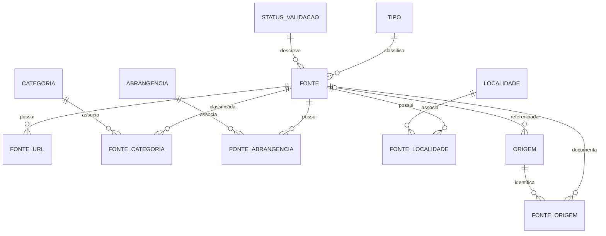

# Catálogo relacional OSINT Rondônia

## Arquitetura

O Data Package v2 publica os CSV sob `data/`. A tabela `fonte` reúne 4.970 fichas, incluindo 391 fontes identificadas nos inventários históricos. Essas novas fichas têm triagem pendente. As sete referências do antigo TODO e a ficha do Atlas da Imprensa também têm triagem pendente.

Os caminhos e hashes dos 4.571 JSON individuais continuam disponíveis no [CSV histórico do commit `12f926c`](https://github.com/Rondoscopio/osint-rondonia/blob/12f926c3052bf84804c30fc8851761eb6f7f8373/data/registro_original.csv). Para as novas fichas extraídas dos inventários, o caminho do documento está em `origem.valor_original`, ligado à ficha por `fonte_origem` com `tipo_origem=origem_cadastro`.

Os [CSV históricos](https://github.com/Rondoscopio/osint-rondonia/tree/89b07610b3e5f4906f5278edfb15f8a0d29dd601/data) continuam recuperáveis no commit `89b0761`. Dos 7.749 itens, 5.551 já apontavam para fichas, 391 originaram fichas e 13 foram associados a fichas por referência ou por nome e endereço. As 22 tarefas foram para o README e 1.772 itens ficaram apenas no histórico. A revisão histórica conserva também a composição original das listas, a ordem, os metadados e os campos que ficaram sem representação no catálogo ativo.

## Filtrar fontes por categoria no SQLite

Cada uma das 19 listas históricas que continham fontes pode ser consultada por uma categoria de curadoria. Isso inclui 14 listas temáticas e cinco listas de importação, referências ou seleção editorial. A relação `fonte_categoria` guarda o vínculo com cada ficha identificada nessas listas, incluindo as 391 fichas incorporadas na migração. Uma ficha pode aparecer em várias categorias. O inventário de tarefas está no README. A ordem, as repetições e os detalhes documentais das listas continuam nos CSV históricos.

Na tabela `categoria`, localize o `id` pelo campo `nome` e confira o `tipo_classificacao`. Vincule esse ID ao parâmetro `:categoria_id` no cliente SQLite.

```sql
SELECT f.id, f.nome, f.descricao
FROM fonte AS f
JOIN fonte_categoria AS fc ON fc.fonte_id = f.id
WHERE fc.categoria_id = :categoria_id
ORDER BY f.nome, f.id;
```

A consulta retorna uma linha por ficha associada à categoria escolhida. Fichas sem categoria continuam disponíveis em `fonte`.

## Diagrama



## Tabelas e chaves

| Recurso | Responsabilidade | Chave primária |
| --- | --- | --- |
| `fonte` | Ficha, atributos escalares comuns, ID externo e status legado | `id` |
| `tipo`, `status_validacao` | Vocabulários exatos encontrados nas fichas | `id` |
| `categoria` | Rótulos de todas as classificações; `tipo_classificacao` distingue `principal`, `original` e `curadoria` | `id` |
| `fonte_categoria` | Relação N:N única entre fontes e categorias, preservando o tipo da categoria associada | chave composta (`fonte_id`, `categoria_id`) |
| `fonte_url` | URL principal e links relacionados; compartilhamento não implica identidade | `id` |
| `abrangencia`, `fonte_abrangencia` | Valores literais de abrangência | `id`; relação composta |
| `localidade`, `fonte_localidade` | Município, UF e país explicitamente declarados, sem completar lacunas | `id`; relação composta |
| `origem` | Valor literal único em `valor_original` e referência opcional a `fonte.id` em `fonte_referenciada_id` | `id` |
| `fonte_origem` | Liga a ficha descrita (`fonte_id`) à origem (`origem_id`) e preserva o campo da ficha (`tipo_origem`) | (`fonte_id`, `tipo_origem`) |

Cada relação declara as chaves estrangeiras no descritor. `fonte.status_triagem` é nulo quando não há estado editorial registrado. `status_validacao` preserva o texto legado, sem traduzi-lo para um estado de aprovação. Disponibilidade de URL não é inferida a partir desses textos.

### Campos e preservação

Os campos escalares observados nas fichas estão em `fonte`; os atributos que representam várias URLs, classificações, abrangências, localidades e proveniência usam tabelas relacionadas. A dimensão `categoria` reúne os rótulos dos campos principal, original e de curadoria, sem fundir termos; `tipo_classificacao` preserva de qual campo cada rótulo veio. `fonte_categoria` é a única relação entre fichas e categorias.

O token `\N` representa valor nulo e está declarado como `missingValues`; ele é reservado e uma colisão literal interrompe a importação explicitamente. Strings vazias continuam vazias. A distinção original entre campo ausente e nulo foi verificada antes do corte e permanece documentada nos dados tipados e no índice histórico; o documento byte a byte deixa de ser recuperável depois da remoção. A exportação não normaliza pontuação, capitalização, idioma, URLs ou rótulos.

As origens documentais de Awesome OSINT, Chelfo API, OSINT Brazuca e Atlas da Imprensa apontam para suas fichas. A URL literal em `origem.valor_original` conserva o endereço registrado no cadastro mesmo se o endereço atual em `fonte_url` mudar. As origens textuais, incluindo as seções do antigo TODO, têm referência nula. Para recuperar a proveniência de uma ficha, junte `fonte_origem.origem_id` a `origem.id`.

## Identificadores

Os IDs atuais são valores persistentes gravados diretamente nas tabelas CSV. Edições devem manter os IDs; uma alteração de nome, descrição ou URL não cria outra identidade. Ao incluir um registro, atribua um novo ID que não exista no respectivo CSV e nunca reutilize IDs removidos. Os IDs `src-*`, `todo-*` e `url-*` existentes foram preservados da importação inicial.

IDs externos (por exemplo, `BRAPI-00001`) ficam em `fonte.id_externo`; nunca substituem a chave interna.

## Execução

Requer Docker com Compose e Just no host. Python, Frictionless e SQLAlchemy ficam na imagem definida em `.config/container/Dockerfile`; os comandos de dados e testes executam dentro do contêiner. `.config` guarda a configuração, `.cache` recebe caches descartáveis e `.local/share/osint-rondonia` é staging ignorado pelo Git. O SQLite publicado é versionado em `data/exports/catalog.sqlite`.

```bash
# Construir a imagem com dependências fixadas
just build

# Validar Data Package, CSV, tipos e relações
just validate

# Testar integridade, exportação SQLite e reprodutibilidade
just test

# Gerar SQLite com todas as tabelas do Data Package
just sqlite

# Executar o gate com comparação do SQLite da revisão
just check
```

`just sqlite` valida primeiro o descritor com Frictionless e as regras relacionais do projeto. O exportador lê as linhas tipadas pelos recursos Frictionless, cria as tabelas com chaves primárias e estrangeiras e grava em staging; só substitui o SQLite versionado depois de passar `integrity_check`, `foreign_key_check` e contagens por tabela. A execução é determinística e uma falha preserva a versão publicada anterior.

O SQLite contém os 12 recursos do pacote. As chaves estrangeiras estão declaradas no arquivo; aplicações que alterarem os dados devem habilitar sua verificação por conexão com `PRAGMA foreign_keys = ON`.

## Contribuições

Para incluir ou alterar uma ficha, edite os CSV e suas relações, mantendo os IDs e respeitando as FKs. Uma ficha precisa ter uma linha em `fonte`; adicione suas categorias, URLs, abrangência, localidade e proveniência nas respectivas tabelas. Para remover uma ficha, remova primeiro as relações que a referenciam. Não reutilize IDs removidos. Rode `just check` antes do pull request.

O workflow `.github/workflows/validar-catalogo.yml` constrói a imagem e executa validação Data Package v2, integridade CSV/FK, testes e comparação do SQLite em Docker. Contexto, objetivo e atividades do antigo backlog estão no README. As sete referências estão em `fonte.csv` e seus links em `fonte_url.csv`; mantenha a triagem como pendente até revisão editorial. A licença AGPL-3.0-or-later cobre o código do repositório; licenças de dados externos não são herdadas automaticamente e não foram declaradas como uma licença única do pacote.

## Gate e auditoria

O check **Gate do catálogo** roda em todos os PRs, inclusive os que alteram
somente documentação, e nos pushes para `main`. `just check` executa as
verificações em Docker e compara o SQLite regenerado com o arquivo do
`HEAD`. Para testar mudanças nos dados, gere o banco com `just sqlite` e
inclua os CSV e o SQLite na mesma revisão. O gate usa a revisão Git como
referência e deixa o SQLite da árvore de trabalho intacto.

`just lint` executa actionlint, zizmor, Hadolint, yamllint, Ruff, ShellCheck e
Gitleaks. A varredura de segredos cobre os arquivos de trabalho, incluindo
os CSV. `just audit` roda Trivy, OSV-Scanner e Semgrep e salva JSON, SBOM
CycloneDX e proveniência em `.local/audit/`. O workflow de auditoria roda
semanalmente na branch padrão e aceita disparo manual. Ele publica os
relatórios mesmo se houver achados ou falha de scanner.

O Dockerfile instala as versões do lockfile em
`.config/container/requirements.txt`. A configuração do Renovate propõe
atualizações por PR quando a integração estiver habilitada no repositório.
Antes de exigir o check na proteção de branch, registre um PR somente com
documentação, um PR com falha intencional e uma auditoria manual com o
artefato associado à revisão.
